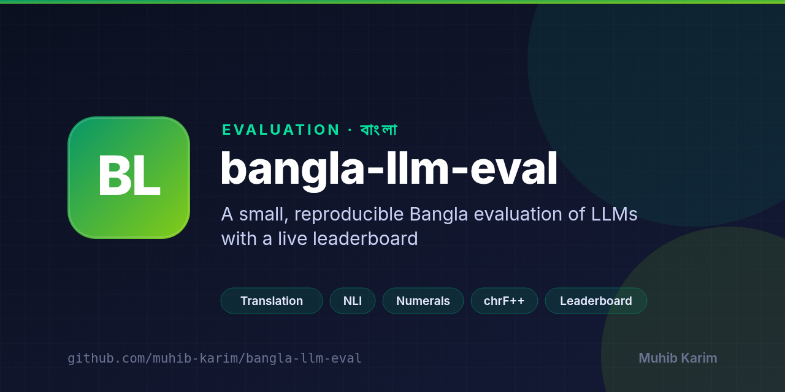

<p align="center">
  
</p>

<p align="center">
  <a href="https://github.com/muhib-karim/bangla-llm-eval/releases/latest"></a>
</p>

# bangla-llm-eval

[](https://github.com/muhib-karim/bangla-llm-eval/actions/workflows/ci.yml)
[](.github/workflows/ci.yml)
[](https://muhib-karim.github.io/bangla-llm-eval/)
[](LICENSE)
[](CITATION.cff)

A small, fixed and reproducible evaluation of large language models on Bangla (Bengali):
translation in both directions, natural-language inference, and Bengali-digit numerals.
Every score in this README is recomputed in CI from the raw model outputs committed in `runs/`,
and a test fails if the results table below differs from the generated `results/table.md`.

**Leaderboard:** https://muhib-karim.github.io/bangla-llm-eval/

## Quickstart

```bash
git clone https://github.com/muhib-karim/bangla-llm-eval.git && cd bangla-llm-eval
python -m venv .venv && . .venv/bin/activate
pip install -r requirements-dev.txt
make check   # lint, types, tests, then rescore every committed run
```

`make check` needs no API key and no model endpoint, and fails if rescoring changes anything
under `results/` or `site/`. Python 3.11 and 3.12 are tested in CI.

## Problem

Bangla has more than 230 million speakers, but model reports rarely break results out for it, and
the numbers that do exist are hard to reproduce: prompts, item lists and raw outputs are usually
not published. This repository is a deliberately small, open alternative: 270 frozen items, the
exact prompts, every raw answer, and a scorer you can run in seconds.

## Measured results (live, 2026-10-17)

One run per model over all 270 items, through the providers' own APIs.

| Model | BN→EN chrF++ | EN→BN chrF++ | NLI acc. | Numerals exact | Median latency (s) | Cost (USD) |
|---|---:|---:|---:|---:|---:|---:|
| Claude Opus 5.5 | 75.40 | 45.39 | 90.0% | 100.0% | 2.24 | 0.978 |
| Claude Sonnet 5 | 64.88 | 47.42 | 77.8% | 100.0% | 1.19 | 0.257 |
| GPT-6 Sol | 61.98 | 42.10 | 77.8% | 100.0% | 1.56 | 0.312 |
| Claude Haiku 4.5 | 62.63 | 48.04 | 74.4% | 60.0% | 0.65 | 0.079 |

Rows are ordered by the sum of the four quality scores. Cost is the whole 270-item suite at list
prices, from the token counts each API returned. Machine-readable scores: [`results/summary.json`](results/summary.json).

**Findings**

- **Reading Bangla is easier than writing it.** Every model scores 15 to 30 chrF++ points lower
  translating into Bangla than out of it, and the order changes: Haiku 4.5 is highest into Bangla
  (48.0) and lowest-cost, while Opus 5.5 leads out of Bangla (75.4). With 60 sentences per
  direction, gaps of two or three points into Bangla are within noise, and Opus 5.5's into-Bangla
  score is slightly understated by answers cut off at the token cap (see [Limits](#limits)).
- **Opus 5.5 is the only model clearly ahead on inference** (90.0% on 90 balanced Bengali XNLI
  items, against 74 to 78% for the others), at three to twelve times the cost.
- **Bengali digits are a real failure mode for the smallest model.** Haiku 4.5 got 24 of 60
  numeral items wrong: 16 of 30 plain digit transcriptions (for example ৭৩৩৯৭৮৯ written as
  733978, one digit dropped) and 8 of 30 arithmetic items. The other three models were exact on all 60.
- **Script compliance is not the problem.** Into-Bangla outputs were 98.9 to 100% Bengali letters
  for every model.

## Tasks

| Task | Items | Source | Metric |
|---|---:|---|---|
| Translation BN→EN | 60 | FLORES-200 devtest, `ben_Beng` → `eng_Latn` | corpus chrF++ (sacrebleu, word order 2) |
| Translation EN→BN | 60 | FLORES-200 devtest, `eng_Latn` → `ben_Beng` | corpus chrF++ |
| Natural-language inference | 90 | Bengali XNLI test split (`csebuetnlp/xnli_bn`), 30 per label | accuracy; first label word in the reply |
| Bangla numerals | 60 | generated: 30 arithmetic in Bengali digits, 30 Bengali→ASCII transcriptions | exact match after trimming spaces, commas and a trailing period |

Items are sampled with a fixed seed (`20261017`) by [`build_items.py`](build_items.py) and frozen
in [`items.jsonl`](items.jsonl); a test fails if the item set changes. Numerals are scored strictly:
an arithmetic answer must be written in Bengali digits as the prompt asks. `summary.json` also
reports a digit-normalised score (Bengali and ASCII digits count as equal; digits of other scripts
do not); for this run the two are identical. The sacrebleu signature of the chrF++ metric is
`nrefs:1|case:mixed|eff:yes|nc:6|nw:2|space:no|version:2.6.0`.

## Reproduce

```bash
pip install -r requirements.txt       # runtime only: enough for make repro
make repro   # rescore all committed runs, rewrite results/ and the leaderboard page
pip install -r requirements-dev.txt   # adds pytest, ruff, mypy and pip-audit
make test    # unit tests and the frozen item-set check
```

`make repro` needs no API key and no network. To re-run a model live against any OpenAI- or
Anthropic-compatible endpoint:

```bash
export BN_EVAL_BASE_URL=https://api.anthropic.com/v1 BN_EVAL_API_KEY=...
make run PROVIDER=anthropic MODEL=claude-haiku-4-5
```

Run settings: one user message per item, no system prompt, 6 requests in flight, up to three
attempts per item (no item ended in an error in this run). Temperature 0 where the endpoint
accepts it, otherwise the provider default; `max_tokens` 512, or `max_completion_tokens` 2048 for
GPT-6 Sol. Opus 5.5, Sonnet 5 and GPT-6 Sol spent thinking or reasoning tokens, which count
toward these caps (see [Limits](#limits)).

Running `make run` again with the same output file resumes: answered items are skipped and items
that ended in an error are tried again. Timeouts, connection errors and HTTP 408/409/429/5xx are
retried; other errors are recorded at once. The command exits non-zero if any item ended in an
error, and each new row records the provider's stop reason.

## Architecture

Four small scripts around three committed data sets (items, raw outputs, scores). Scoring and the
leaderboard need no network. Details: [docs/ARCHITECTURE.md](docs/ARCHITECTURE.md).

| Script | Reads | Writes |
|---|---|---|
| `build_items.py` | source datasets in `data/` (not committed) | `items.jsonl` (frozen) |
| `run_eval.py` | `items.jsonl`, a model endpoint | `runs/<model>.jsonl` |
| `score.py` | `items.jsonl`, `runs/*.jsonl` | `results/summary.json` |
| `report.py` | `results/summary.json`, `site/template.html` | `results/table.md`, `site/index.html` |

## Limits

- One run per model. Repeat runs were not measured, so run-to-run variance is unknown.
- Some answers were cut off by the 512-token cap, because thinking tokens count toward it. Six
  Opus 5.5 rows (`mt-en-bn-503`, `-520`, `-543`, `-865`, `-967` and `nli-334`) and one Sonnet 5 row
  (`mt-en-bn-983`) used exactly 512 output tokens. On the 54 EN→BN sentences where no model hit
  the cap, chrF++ is 49.12 for Haiku 4.5, 48.57 for Sonnet 5, 47.49 for Opus 5.5 and 43.09 for
  GPT-6 Sol: the same order as the table, with Opus 1.6 points behind Haiku instead of 2.7. The
  published scores are left as measured.
- The two translation directions use different sentences. The 120 sampled FLORES-200 devtest
  lines were sorted before being split, so BN→EN uses line indices 4 to 439 and EN→BN uses 448
  to 997.
- Small samples: 60 sentences per translation direction and 90 NLI items. On 90 items a 95%
  interval is roughly ±8 points, so only large gaps are meaningful.
- FLORES-200 and XNLI are public. Models may have seen them in training, which would inflate scores;
  this suite cannot rule that out.
- chrF++ rewards character overlap with one reference. It is not a human judgement of fluency.
- Bangla here is standard written Bangla. Dialects and romanised Bangla are not covered.

## Data and licences

Code is MIT ([LICENSE](LICENSE)). `items.jsonl` and `runs/` contain text from third-party datasets
under their own licences: FLORES-200 sentences are CC BY-SA 4.0, and Bengali XNLI items are
CC BY-NC-SA 4.0 (non-commercial). The numeral items are generated by this repository. Raw source
files are not redistributed; the `build_items.py` docstring describes the input layout it expects.

## Tech stack

- **Scoring:** Python, chrF++ (sacrebleu), accuracy for NLI and numerals
- **Data:** FLORES-200, Bengali XNLI and generated numeral items, frozen in `items.jsonl`
- **Runner:** any OpenAI- or Anthropic-compatible endpoint
- **Publishing:** CI recomputes every score; the leaderboard is on GitHub Pages
- **Quality gates:** ruff, mypy (strict), pytest and gitleaks in CI; pip-audit weekly

## Contributing

Issues and pull requests are welcome. Run `make check` (no API key or model endpoint needed) before opening a pull request; new runs should commit their raw outputs. Please keep each pull request focused and say how you tested it.

## Citation

If you use this suite, please cite it ([CITATION.cff](CITATION.cff)):

```bibtex
@software{karim_bangla_llm_eval_2026,
  author  = {Karim, Muhib},
  title   = {bangla-llm-eval: a small reproducible Bangla evaluation for large language models},
  year    = {2026},
  url     = {https://github.com/muhib-karim/bangla-llm-eval}
}
```

and the datasets and metric it builds on:

- NLLB Team et al. (2022). *No Language Left Behind: Scaling Human-Centered Machine Translation.* (FLORES-200)
- Bhattacharjee et al. (2022). *BanglaBERT: Language Model Pretraining and Benchmarks for Low-Resource Language Understanding Evaluation in Bangla.* Findings of NAACL. (Bengali XNLI)
- Popović, M. (2017). *chrF++: words helping character n-grams.* WMT.
- Post, M. (2018). *A Call for Clarity in Reporting BLEU Scores.* WMT. (sacrebleu)
